<p align="center">
  
</p>

<h1 align="center">CrypShare</h1>

<p align="center">
  <strong>Zero-Knowledge File Sharing for the Paranoid</strong>
</p>

<p align="center">
  <a href="LICENSE"></a>
  <a href="https://github.com/Iosif-Christogeorgos/Individual-Project/actions/workflows/ci.yml"></a>
  
  
  
</p>

<p align="center">
  End-to-end encrypted file sharing where <strong>the server only stores ciphertext</strong>.<br/>
  No accounts. No passwords. Files expire automatically.
</p>

---

## 🔐 What is CrypShare?

CrypShare is a file-sharing platform with a zero-knowledge storage design. Files are encrypted entirely on the client using AES-256-GCM before upload, so the server only ever stores ciphertext. Recipients decrypt locally using either a shareable link key or identity-based encryption with ECDH key exchange.

A stolen database or storage bucket doesn't expose your files, and a file altered in storage fails to decrypt. See [SECURITY.md](SECURITY.md) for exactly what this does and doesn't protect against, including the limits of trusting the server that delivers the code.

---

## ✨ Key Features

### 🚀 Two Sharing Modes

| Mode             | Description                                                     | Best For                              |
| ---------------- | --------------------------------------------------------------- | ------------------------------------- |
| **Quick Share**  | Anonymous, link-based sharing with key embedded in URL fragment | One-time transfers, no setup required |
| **Secure Share** | Identity-based encryption for specific recipients               | Recurring contacts, maximum security  |

### 🛡️ Security Features

| Feature                 | Threat                         | Solution                                                  |
| ----------------------- | ------------------------------ | --------------------------------------------------------- |
| **🔒 File integrity**   | Stored files being altered     | Each chunk authenticated with its position (AES-GCM AAD)  |
| **✍️ Sender signatures** | Impersonation                  | ECDSA signatures checked against your saved contacts      |
| **⚡ DoS protection**   | Resource exhaustion            | Rate limits, size limits, statement timeouts, validation  |
| **🎭 Key verification** | Swapped public keys            | Fingerprints computed locally, to compare out of band     |
| **👁️ Privacy**          | Recipients seeing each other   | Separate recipient table, looked up per fingerprint       |
| **💾 Data safety**      | Key loss or device change      | PBKDF2-encrypted identity backups                         |
| **🗑️ Cleanup**          | Files outliving their expiry   | Scheduled cleanup plus R2 lifecycle rules                 |

---

## 🏗️ Architecture

```mermaid
flowchart TB
    subgraph Client ["🖥️ Client (Browser)"]
        UI[Web UI]
        WC[WebCrypto API]
        IDB[(IndexedDB<br/>Identity Vault)]
    end

    subgraph Server ["⚙️ Backend (Node.js)"]
        API[Express API]
        VAL{Validation<br/>& Rate Limiting}
    end

    subgraph Storage ["☁️ Cloud Infrastructure"]
        R2[(Cloudflare R2<br/>Encrypted Blobs)]
        SB[(Supabase<br/>Metadata + Keys)]
    end

    subgraph SB_Detail ["Supabase Tables"]
        FILES[files<br/>Public Metadata]
        RECIP[file_recipients<br/>🔐 Zero-Knowledge Vault]
        PUBKEYS[public_keys<br/>Identity Directory]
    end

    UI -->|1. Select File| WC
    WC -->|2. Generate AES Key| WC
    WC -->|3. Encrypt File| WC
    WC -->|4. Encrypt Key for Recipients| WC

    WC -->|5. Upload Ciphertext| API
    API --> VAL
    VAL -->|6. Store Blob| R2
    VAL -->|7. Store Metadata| FILES
    VAL -->|8. Store Recipient Keys| RECIP

    IDB -.->|Load Identity| WC
    PUBKEYS -.->|Lookup Recipients| API

    style RECIP fill:#1a1a2e,stroke:#00ff41,stroke-width:2px
    style WC fill:#1a1a2e,stroke:#00d4ff,stroke-width:2px
    style IDB fill:#1a1a2e,stroke:#8b5cf6,stroke-width:2px
```



### Data Flow

1. **Encryption** happens entirely in the browser using the Web Crypto API
2. **Upload** sends only ciphertext—the server never sees plaintext
3. **Metadata** is stored separately from encrypted blobs (defense in depth)
4. **Recipient Keys** are stored in a segregated vault—recipients cannot see each other
5. **Download** retrieves ciphertext, decryption happens client-side

---

## 🔬 Security Model

### What the Server Can See

| Data            | Stored on the server                                           |
| --------------- | -------------------------------------------------------------- |
| File content    | Ciphertext only                                                |
| File name       | Encrypted. Signed files also store a hash of it                |
| File key        | Never. Link keys stay in the `#` fragment; recipient keys are encrypted to the recipient |
| Recipients      | Their key fingerprints, which map to usernames in the directory |
| Sender          | Name and public key, for signed files                          |
| Plaintext hash  | SHA-256 for Secure Share files, which can confirm a guessed file |
| Access patterns | File sizes, timestamps and IP addresses                        |

### File Integrity

Files use a chunked AES-256-GCM format. Each chunk's position and the total chunk count are authenticated as additional data, so reordering, removing, duplicating or appending chunks makes decryption fail. Database triggers also stop metadata such as a file's hash, size and expiry being changed through normal queries, though someone with full database access could remove them.

### Sender Signatures

A signature's name and key come from the uploader, so a valid signature alone doesn't prove who sent a file. CrypShare checks that the signature covers the decrypted file, then shows the sender as confirmed only if the signing key belongs to one of your contacts.

### Client-Side Fingerprints

```javascript
// Compute the fingerprint locally rather than trusting the server's value
const computedFingerprint = await generateKeyFingerprint(publicKey);
```

Fingerprints are computed in the browser using canonical JSON and SHA-256. This proves a fingerprint matches the key you received. To rule out a swapped key, compare the fingerprint with the other person over another channel.

### Segregated Recipient Vault

```
┌─────────────────────────────────────────────────────────┐
│  files table (public)                                   │
│  ├─ id, size, content_hash, expires_at                 │
│  └─ metadata (accessModes, signature, etc.)            │
├─────────────────────────────────────────────────────────┤
│  file_recipients table (RLS protected)                  │
│  ├─ file_id                                             │
│  ├─ recipient_fingerprint  ← Lookup key                │
│  └─ encrypted_key          ← Only useful to recipient  │
└─────────────────────────────────────────────────────────┘
```

Recipients query only by their fingerprint, so they cannot enumerate other recipients. The server does hold the full list, because it stores the rows.

---

## 🚀 Getting Started

### Prerequisites

- **Node.js** 22.13+
- **Supabase** account (free tier works)
- **Cloudflare R2** bucket (free tier: 10GB)

### Environment Variables

Create a `.env` file in the `backend/` directory (see `backend/.env.example`):

```env
# Server (optional)
PORT=3000
ALLOWED_ORIGINS=http://localhost:3000,http://127.0.0.1:3000

# Supabase (Database)
SUPABASE_URL=https://your-project.supabase.co
SUPABASE_SERVICE_ROLE_KEY=your-service-role-key

# Cloudflare R2 (Storage)
R2_ENDPOINT=https://your-account-id.r2.cloudflarestorage.com
R2_ACCESS_KEY_ID=your-access-key
R2_SECRET_ACCESS_KEY=your-secret-key
R2_BUCKET_NAME=crypshare-files
```

### Database Setup

1. Go to your Supabase SQL Editor
2. Execute the schema file:

```bash
# The schema includes:
# - Tables: files, file_recipients, public_keys, upload_tokens, ownership_nonces
# - RLS Policies: Default-deny with RPC-only access
# - Triggers: Integrity protection, auto-cleanup
# - Functions: Secure metadata/key retrieval RPCs
```

```sql
-- Run the complete schema
\i backend/schema.sql
```

The schema can be re-run safely on an existing database, which is how to apply updates to it.

### R2 Lifecycle Rules

Configure automatic cleanup in Cloudflare Dashboard:

| Rule                     | Action | Condition      |
| ------------------------ | ------ | -------------- |
| Abort Incomplete Uploads | Delete | After 1 day    |
| Delete Expired Files     | Delete | After 8 days\* |

_\*7 days max expiry + 1 day buffer_

### Installation

```bash
# Clone the repository
git clone https://github.com/Iosif-Christogeorgos/Individual-Project.git
cd Individual-Project

# Install backend dependencies
cd backend
npm install

# Copy .env.example to .env and fill in your values
cp .env.example .env

# Start the server
npm start

# Open http://localhost:3000
```

### Development

Run these from the `backend/` directory. No cloud accounts are needed: the tests use the real server with an in-memory stand-in for Supabase and R2, and a real Postgres engine for the schema.

```bash
npm test             # Run all tests
npm run test:watch   # Re-run tests on change
npm run lint         # Lint backend and frontend
```

---

## 📖 Usage Guide

### Quick Share (Anonymous)

1. Navigate to **Quick Share**
2. Select expiry time (1h - 7 days)
3. Drop or select a file
4. Click **Encrypt & Upload**
5. Share the generated link (key is in URL fragment `#`)

> 💡 The key after `#` never leaves your browser—it's not sent to the server.

### Secure Share (Identity-Based)

1. Navigate to **Secure Share**
2. **First time?** Create your identity:
   - Enter a username
   - Your cryptographic keypair is generated locally
   - Only the public key is published
3. Add recipients by searching their username
4. Select recipients and upload
5. Share the link—only selected recipients can decrypt

### Identity Backup

1. Click **Export Backup** in the Identity Vault
2. Enter a strong password (min 8 characters)
3. Download the encrypted `.json` file
4. Store it safely—this is your recovery key

> ⚠️ **If you lose both your browser data AND backup, your identity is gone forever.**

---

## 🔧 API Reference

### File Operations

| Endpoint                              | Method   | Description                                      |
| ------------------------------------- | -------- | ------------------------------------------------ |
| `/upload`                             | `POST`   | Upload ciphertext as a multipart form            |
| `/upload-stream`                      | `POST`   | Upload ciphertext as a raw stream (large files)  |
| `/download/:fileId`                   | `GET`    | Download ciphertext                              |
| `/download/:fileId`                   | `HEAD`   | Check a file exists and get its size             |
| `/file/:fileId`                       | `DELETE` | Delete a file (requires upload token)            |
| `/metadata/:fileId`                   | `POST`   | Store file metadata (requires upload token)      |
| `/metadata/:fileId`                   | `GET`    | Retrieve file metadata                           |
| `/recipient-key/:fileId/:fingerprint` | `GET`    | Get the encrypted key for a recipient            |

Uploads are limited to 375MB. Each upload returns a one-time upload token.

### Identity Operations

| Endpoint                           | Method | Description                                        |
| ---------------------------------- | ------ | -------------------------------------------------- |
| `/pubkey`                          | `POST` | Register or update a public key (requires a proof) |
| `/pubkey/:id`                      | `GET`  | Look up a user by ID                               |
| `/pubkey/username/:username`       | `GET`  | Look up a user by username                         |
| `/pubkey/fingerprint/:fingerprint` | `GET`  | Look up a user by fingerprint                      |
| `/pubkey/check/:username`          | `GET`  | Check whether a username is available              |

---

## 🧪 Cryptographic Primitives

| Purpose           | Algorithm        | Parameters                          |
| ----------------- | ---------------- | ----------------------------------- |
| File Encryption   | AES-256-GCM      | 256-bit key, 96-bit IV, 64KB chunks, position bound as AAD |
| Key Exchange      | ECDH             | P-256 (secp256r1)                   |
| Signatures        | ECDSA            | P-256 + SHA-256                     |
| Fingerprints      | SHA-256          | Canonical JSON of JWK               |
| Backup Encryption | PBKDF2 + AES-GCM | 600,000 iterations, 256-bit key     |

---

## 📁 Project Structure

```
├── .github/                # CI workflow and Dependabot config
├── backend/
│   ├── server.js           # Express API server
│   ├── schema.sql          # Complete database schema
│   ├── eslint.config.js
│   └── tests/              # API, crypto, schema and UI tests
├── frontend/
│   ├── index.html          # Landing page
│   ├── quick.html          # Quick Share UI
│   ├── secure.html         # Secure Share UI
│   ├── download.html       # Download & decrypt UI
│   ├── crypto.js           # WebCrypto operations
│   ├── identity.js         # Identity management
│   ├── secure.js           # Secure Share logic
│   ├── quick.js            # Quick Share logic
│   ├── download.js         # Download logic
│   └── styles.css          # Cyber-glass design
├── Dockerfile
├── LICENSE
├── README.md
└── SECURITY.md             # Threat model and how to report vulnerabilities
```

---

## 🛡️ Security Considerations

### What CrypShare Protects Against

✅ Theft of the database or storage bucket (files are encrypted client-side)
✅ Stored files being altered, reordered or cut short
✅ Uploaders impersonating your contacts
✅ Identity takeover and replayed registration requests
✅ Recipients discovering each other

### What CrypShare Does NOT Protect Against

❌ A server that delivers modified code, which applies to all browser-based encryption
❌ Key substitution, unless you compare fingerprints over another channel
❌ Compromised client device
❌ Weak passwords for identity backup
❌ Coerced key disclosure
❌ Traffic analysis (timing, file sizes)

See [SECURITY.md](SECURITY.md) for the full threat model and how to report a vulnerability.

---

## 📄 License

This project is licensed under the MIT License - see the [LICENSE](LICENSE) file for details.

---

## 🙏 Acknowledgments

- [Web Crypto API](https://developer.mozilla.org/en-US/docs/Web/API/Web_Crypto_API) - Browser-native cryptography
- [Supabase](https://supabase.com) - Open source Firebase alternative
- [Cloudflare R2](https://www.cloudflare.com/r2/) - S3-compatible object storage
- [Lucide Icons](https://lucide.dev) - Beautiful open source icons

---

<p align="center">
  <strong>Built with ❤️ and Cryptography</strong>
</p>
